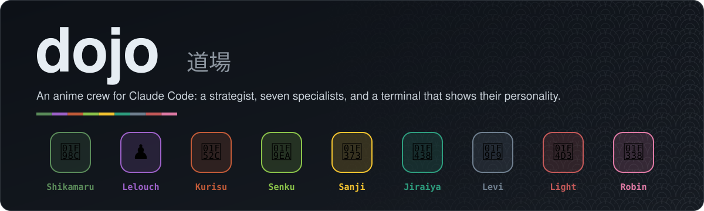
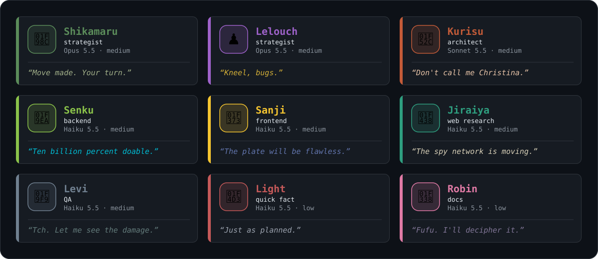
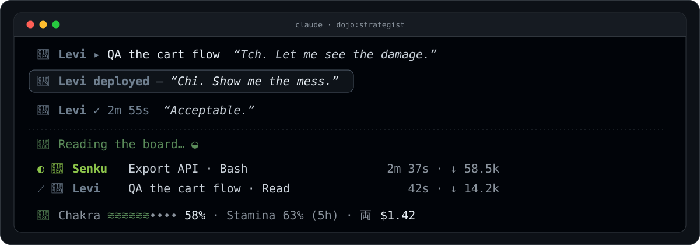

# dojo

<p align="center"></p>

<p align="center">
<a href="https://img.shields.io/badge/version-0.8.0-9E62CA"></a>
<a href="https://img.shields.io/badge/Claude%20Code-plugin-9E62CA"></a>
<a href="https://img.shields.io/badge/license-MIT-9E62CA"></a>
</p>

An anime crew for Claude Code: a strategist, seven specialists, and a terminal that shows their personality.

## Install

```
/plugin marketplace add shreym95/dojo
/plugin install dojo@dojo
```

Launch the strategist with `claude --agent dojo:strategist` or pin it in `settings.json` with `"agent": "dojo:strategist"`. Use `crew` to show the on-duty persona; pass `crew shikamaru` or `crew lelouch` to pin one. Override with `DOJO_STRATEGIST=shikamaru|lelouch` or set `DOJO_DEBUG=1` to log hook input to `${TMPDIR:-/tmp}/dojo-hook-debug.log`.

## The crew



| Agent | Character | Role | Model | Effort |
|---|---|---|---|---|
| `dojo:strategist` | Shikamaru or Lelouch | Orchestrator / integrator (main thread) | claude-opus-5-5 | medium |
| `dojo:senku` | Senku | Backend builder | claude-haiku-5-5 | medium |
| `dojo:sanji` | Sanji | Frontend builder | claude-haiku-5-5 | medium |
| `dojo:kurisu` | Kurisu | Solutions architect | claude-sonnet-5-5 | medium |
| `dojo:jiraiya` | Jiraiya | Web researcher | claude-haiku-5-5 | medium |
| `dojo:light` | Light | Quick fact-finder | claude-haiku-5-5 | low |
| `dojo:levi` | Levi | QA inspector (read-only) | claude-haiku-5-5 | medium |
| `dojo:robin` | Robin | Documentation writer | claude-haiku-5-5 | low |

## How work flows

- **One fast fact**: → `dojo:light`, replies `NOT FOUND` if the answer is not at hand.
- **Multi-source investigation**: → `dojo:jiraiya`, cited findings with confidence per claim.
- **Options, designs, hypotheses, POCs, test methodology**: → `dojo:kurisu`, replies `NEEDS INTEL: <exact question>` for research beyond targeted lookups.
- **Build**: → `dojo:senku` (behaviour and data) or `dojo:sanji` (presentation and interaction), reply `BLOCKED: <question>` instead of guessing.
- **QA and verification**: → `dojo:levi`, read-only.
- **Write or update docs**: → `dojo:robin`, from existing code or decisions already made.
- **Make the decision**: → the strategist, using crew output as input.

Senku owns behaviour and data; Sanji owns presentation and interaction. The seam is a data contract.

## In your terminal



- **Crew moments**: one-line deploy, return, and fall lines with emoji and signature quote.
- **Toasts**: in-character text on deploy (3s), return (5s), fall (6s), and rank-up (7s).
- **Crew band**: one animated row per running subagent above the prompt (glyph, emoji, name, task, tool, elapsed time, live tokens).
- **Usage line**: row above the prompt with context fill (Chakra), busiest rate-limit (Stamina, ≥25%), and cost (両).
- **Spinners**: main thread shows strategist verbs; crew members show their own emoji and verbs.
- **Palette mode**: light-theme colors on white, dark colors lifted to 4.5:1 on black across spinners, band, transcript, chrome.
- **Transcript theme**: persona frame on strategist replies; crew cards in character colors on tool calls, results, errors.
- **Crew cards**: opt-in with `banners` toggle (off by default); ASCII banners on deploy/return/fall.
- **Prompt chrome**: session mode tagged with strategist emoji and name.
- **Roster pane** (`/dojo`): the crew, who is on duty and running, per-crew session stats, rank.
- **Mission report** (`/dojo-recap`): crew deployed, runs, time, tokens, last quote, who fell, final context and cost, rank, strategist sign-off.
- **Gallery** (`/dojo-gallery`): preview each character's banner, colors, animation frames, spinner verbs, signature lines, speech bubble.
- **Rank across sessions**: grows with every dojo crew member that returns. Shikamaru/neutral: Genin / Chūnin / Jōnin / Kage; Lelouch: Pawn / Knight / Rook / King. Thresholds: 0 / 25 / 100 / 300 points.

## Guards

- **Commit gate** (on by default): forces Conventional Commits (subject ≤72 chars, no body), denies commits that break the rules, injects the configured Co-Authored-By trailer (default `Co-Authored-By: Claude`).
- **Delegation budgets** (on by default): caps the main thread's inline edits (2 files, 6 lines) and lookups (3 per turn); points to dojo:senku, dojo:sanji, dojo:jiraiya or dojo:light.
- **Architect write guard** (on by default): keeps dojo:kurisu's file writes to the scratchpad, system temp dir or an isolated worktree; Bash is not checked.
- **Compaction memory** (on by default): keeps the on-duty line, voice level, running dojo agents with their tasks, and user decisions in summaries.
- **Model guard** (always on): strips `model` from any `dojo:*` agent spawn so the agent's own frontmatter model always wins.

## Commands

| Command | What it does |
|---|---|
| `/dojo-duty [shikamaru\|lelouch]` | Show or switch the strategist persona on duty. |
| `/dojo-voice [subtle\|medium\|full\|default\|reset\|off]` | Show or set the dojo voice level for this session. |
| `/dojo` | Open the roster pane (requires `rosterPane` toggle on). |
| `/dojo-recap` | Open the mission report (requires `rosterPane` toggle on). |
| `/dojo-gallery` | Browse each character's banner, colors, spinner verbs, signature lines. |

## Settings

<details><summary>All settings (/config)</summary>

| Key | Default | What it does |
|---|---|---|
| `spinners` | true | Replace the spinner word with the on-duty strategist's (or crew member's) themed verbs. |
| `turnFlair` | true | Past-tense themed word on the line that closes a turn (Outmaneuvered, Checkmated). |
| `band` | true | Show one animated row per running dojo subagent above the prompt. |
| `usageLine` | true | Show one row above the prompt with the session's context fill (Chakra) and the cost, plus the busiest rate-limit window (Stamina) once it passes 25%. |
| `toasts` | true | Short in-character toast when a dojo subagent is deployed, returns or falls, and when the crew rank goes up. |
| `neutralMainTheme` | true | When no strategist persona is detected, still theme the main spinner with a neutral strategist pool. |
| `commitGate` | true | Force the configured commit trailer into git texts and deny git commit commands whose inline message breaks the commit rules (Conventional Commits subject, no body, exact trailer). Applies in every session. |
| `commitTrailer` | `Co-Authored-By: Claude` | The exact Co-Authored-By line commits must carry. Empty keeps Claude Code's own text and skips the trailer check. |
| `roleGuard` | true | In a dojo session, cap the main thread's inline edits and web lookups per turn and point it at dojo:senku, dojo:sanji, dojo:jiraiya or dojo:light. |
| `architectGuard` | true | Keep dojo:kurisu's file writes out of the main working tree: Edit, Write and NotebookEdit are allowed only in the scratchpad, the system temp dir or an isolated worktree. Bash is not checked. |
| `inlineEditFiles` | 2 | Distinct files the main thread may edit itself in one turn before it must delegate. |
| `inlineEditLines` | 6 | Largest Edit (lines in new_string) the main thread may make itself. |
| `inlineLookups` | 3 | WebSearch and WebFetch calls the main thread may make itself in one turn before it must delegate. |
| `archivist` | true | In a dojo session, tell the compaction summary to keep the on-duty line, the voice level, running dojo agents with their tasks, and the user's decisions. |
| `transcriptTheme` | true | Frame messages, tool calls and subagent results in the on-duty character's colors: persona frames on messages, tool badges, crew cards and speech bubbles. |
| `banners` | false | Show full ASCII-banner crew cards in the transcript instead of one-line deploy/return lines. |
| `promptChrome` | true | Tag the session mode line under the prompt with the on-duty strategist's emoji and name, in its color. |
| `rosterPane` | true | Show the /dojo roster panel: the crew, who is on duty and who is running. |
| `sounds` | true | Play a sound cue when a dojo subagent is deployed, returns or falls (macOS only). |
| `paletteMode` | `auto` | Colors of the dojo chrome and transcript. `auto` follows the Claude Code theme (light when its name contains "light"); `dark` and `light` force one. Light-theme colors meet ≥4.5:1 on white; dark colors are lifted to ≥4.5:1 on black. |
| `rank` | true | Keep a rank that grows with every dojo crew member that returns, across sessions. Shown in `/dojo` and `/dojo-recap`, with a toast on rank-up. Ladder: Shikamaru/neutral (Genin / Chūnin / Jōnin / Kage), Lelouch (Pawn / Knight / Rook / King); thresholds 0 / 25 / 100 / 300 points. |

</details>

## Customise

Edit `roster.mjs` (characters, models, tools), `personas/*.md` (voice sheets), `roles/*.md` (duties) or `shared/house-rules.md`, then:

```
npm run build   # regenerate agents/*.md
npm run check   # fail if agents/ has drifted (used in CI)
npm test
```

`agents/*.md` is generated; do not edit by hand.

Visuals and art: edit `mods/theme.ts` for character emoji and colors; `mods/visuals/transcript-art.ts` for banners and speech bubbles; `mods/visuals/chrome-art.ts` for spinners, turn-end words, toasts, and band rows.

## Develop

Validate, test and try the plugin locally:

```
claude plugin validate .   # check the hook structure
claude plugin test .       # run the mod suite
claude --plugin-dir .      # try the plugin locally without installing
```

Persona sheets live in `personas/`; roles in `roles/`; character art in `mods/visuals/`.

## Notes

- **Sound cues**: macOS only (via `afplay`).
- **Claude Code's agent list**: cannot be hidden or restyled by a plugin; the crew band draws alongside it.
- **mods API**: early access; breaking changes may occur.
- **Model guard**: never pass `model` to dojo agents; the model guard enforces each agent's own frontmatter model.

## License

MIT
